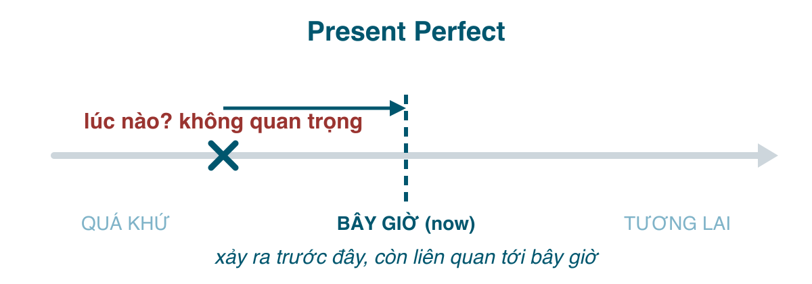

Nếu phải chọn một thì khiến người Việt khổ nhất, tôi chọn hiện tại hoàn thành. Lý do rất cụ thể: tiếng Việt dịch nó là "đã", mà "đã" cũng dùng cho quá khứ đơn. *Tôi đã ăn* có thể là *I ate* hoặc *I have eaten*, và tiếng Việt không bắt bạn phân biệt. Tiếng Anh thì bắt, và chọn sai là một trong những lỗi người bản xứ nhận ra ngay.

Chìa khóa nằm ở chính cái tên: **present** perfect. Nó là một thì **hiện tại**. Hành động xảy ra trong quá khứ, nhưng người nói đang đứng ở hiện tại nhìn về, và điều họ quan tâm là **tình trạng bây giờ**: kết quả của việc đó, kinh nghiệm tích lũy tới giờ, hay việc đó kéo dài tới tận bây giờ. *Lúc nào* xảy ra không quan trọng, thậm chí không được nói ra.

#### Công thức

| | |
|---|---|
| Khẳng định | I/You/We/They **have worked**. He/She/It **has worked**. |
| Phủ định | I **haven't worked**. She **hasn't worked**. |
| Câu hỏi | **Have** you **worked**? **Has** she **worked**? |

<mark>V3</mark> là quá khứ phân từ (past participle): động từ có quy tắc thêm <mark>-ed</mark> (giống V2), động từ bất quy tắc thì phải học cột thứ ba: <mark>go → went → gone</mark>, <mark>see → saw → seen</mark>, <mark>eat → ate → eaten</mark>, <mark>write → wrote → written</mark>, <mark>do → did → done</mark>, <mark>be → was/were → been</mark>. Viết tắt: *I've, you've, he's, she's, we've, they've*. Lưu ý <mark>he's</mark> vừa là *he is* vừa là *he has*; nhìn từ sau nó để biết: *he's working* (is), *he's worked* (has).

#### Khi nào dùng
**1. Việc đã xảy ra, kết quả còn ở hiện tại.** Không nói lúc nào. Người nói quan tâm tới hậu quả bây giờ.
- I'**ve lost** my keys. (Tôi làm mất chìa khóa rồi → *giờ* không vào nhà được.)
- She'**s broken** her leg. (Cô ấy gãy chân → *giờ* đang bó bột.)
- The taxi **has arrived**. (Taxi tới rồi → *giờ* đang đợi ngoài cửa.)
- I'**ve finished** the report. (Xong rồi → *giờ* anh đọc được.)

So sánh với quá khứ đơn: *I lost my keys yesterday* chỉ kể chuyện hôm qua; có thể hôm nay đã tìm thấy rồi.

**2. Kinh nghiệm trong đời, tính tới bây giờ.** "Đã từng" hoặc "chưa từng". Thường đi với <mark>ever, never, before, X times</mark>.
- **Have** you **ever been** to Japan? (Cậu đã từng đi Nhật chưa?)
- I'**ve never eaten** snake. (Tôi chưa bao giờ ăn thịt rắn.)
- I'**ve seen** this film three times. (Tôi xem phim này ba lần rồi.)
- She'**s worked** for four different companies. (Cô ấy đã làm cho bốn công ty.)

Cái "đời" này chưa kết thúc, nên có thể còn thêm lần nữa. Khi khoảng thời gian đã đóng lại thì phải dùng quá khứ đơn: *My grandfather **visited** Paris twice* (ông đã mất).

**3. Việc bắt đầu trong quá khứ và kéo dài tới bây giờ.** Với <mark>for</mark> (trong bao lâu) và <mark>since</mark> (từ khi nào). Đây là chỗ tiếng Việt dùng *thì hiện tại* ("tôi sống ở đây 10 năm *rồi*") nên người Việt hay viết sai thành hiện tại đơn.
- I'**ve lived** here **for** ten years. (Tôi sống ở đây 10 năm rồi, và vẫn đang sống.)
- We'**ve known** each other **since** 2015. (Quen nhau từ 2015.)
- **How long have** you **worked** there? (Làm ở đó bao lâu rồi?)
- She **hasn't called** me **since** Monday.

Với động từ hành động (<mark>work, study, wait, rain</mark>), nghĩa này thường dùng hiện tại hoàn thành tiếp diễn (bài 177). Với động từ trạng thái (<mark>be, know, have, live, like</mark>), bắt buộc dùng hiện tại hoàn thành vì chúng không có dạng tiếp diễn.

**4. Việc vừa mới xảy ra, hoặc trong khoảng thời gian chưa kết thúc.** Với <mark>just, already, yet, recently, lately, today, this week, this year, so far</mark>.
- I'**ve just had** lunch. (Vừa ăn trưa xong.)
- She'**s already left**. (Cô ấy đi rồi.)
- **Have** you **finished yet**? / I **haven't finished yet**. (Xong chưa? / Chưa xong.)
- I'**ve had** three coffees **today**. (Hôm nay uống ba ly rồi; hôm nay chưa hết.)
- We'**ve sold** 200 units **so far this month**.

Vị trí: <mark>just, already</mark> đứng giữa <mark>have</mark> và <mark>V3</mark>; <mark>yet</mark> đứng cuối câu phủ định và câu hỏi.

#### been vs. gone
- *She **has gone** to Hanoi.* = đi rồi, **đang ở đó** hoặc trên đường, chưa về.
- *She **has been** to Hanoi.* = **đã từng** đi, giờ đã về.

Hỏi *Have you ever gone to Japan?* nghe hơi lạ; kinh nghiệm thì dùng <mark>been</mark>.

#### Dấu hiệu nhận biết
<mark>ever, never, before, just, already, yet, recently, lately, so far, up to now, for + khoảng thời gian, since + mốc thời gian, this week/month/year, today, how long, X times, the first/best/only ... (that) I've ...</mark>

Cấu trúc hay gặp: *This is the **best** phở I'**ve ever had**.* (Đây là tô phở ngon nhất tôi từng ăn.) / *It's the **first time** I'**ve been** here.*

#### So sánh với thì dễ nhầm
**Hiện tại hoàn thành vs. Quá khứ đơn.** Đây là so sánh quan trọng nhất của cả series. Nguyên tắc: **có thời điểm cụ thể trong quá khứ → quá khứ đơn. Không có, và quan tâm tới bây giờ → hiện tại hoàn thành.**

| Present Perfect | Past Simple |
|---|---|
| I'**ve seen** that film. (từng xem, không biết lúc nào) | I **saw** that film **last week**. |
| She'**s lived** here for 5 years. (vẫn ở) | She **lived** here for 5 years. (đã chuyển đi) |
| **Have** you **had** breakfast? (sáng nay, còn liên quan: giờ đói không) | **Did** you **have** breakfast **this morning**? (nói vào buổi chiều, buổi sáng đã qua) |
| I'**ve been** to Hue. (kinh nghiệm) | I **went** to Hue **in 2019**. |
| He **has written** three books. (còn sống, có thể viết thêm) | Nguyễn Du **wrote** Truyện Kiều. (đã mất) |

Các từ chỉ thời điểm đã kết thúc **không bao giờ** đi với hiện tại hoàn thành: <mark>yesterday, last week, in 2019, two days ago, when I was a child, at 5 o'clock</mark>. Thấy chúng là quá khứ đơn, không bàn cãi. Lỗi ~~I have been to Hanoi yesterday~~ là lỗi số một của người Việt với thì này.

Ngược lại, một mẩu hội thoại điển hình đổi thì giữa chừng: *"**Have** you **ever been** to Hue?" "Yes, I **have**." "When **did** you **go**?" "I **went** there two years ago. It **was** beautiful."* Câu đầu hỏi kinh nghiệm (hoàn thành), ngay khi hỏi *when* là chuyển sang quá khứ đơn vì đã bắt đầu nói về một thời điểm cụ thể.

Một lưu ý về Anh-Mỹ: người Mỹ hay dùng quá khứ đơn với <mark>just, already, yet</mark> (*Did you eat yet? I already ate.*). Cả hai cách đều đúng; bài thi IELTS/Cambridge theo chuẩn Anh, nên cứ giữ hiện tại hoàn thành.

**Hiện tại hoàn thành vs. Hiện tại đơn** cho nghĩa "từ ... tới giờ": ~~I live here for 10 years~~ là sai, tiếng Anh không dùng hiện tại đơn với <mark>for/since</mark> theo nghĩa này. Phải là *I've lived here for 10 years* (hoặc *I've been living*).

#### Lỗi người Việt hay mắc
- **Hiện tại hoàn thành + thời điểm quá khứ**: ~~I have met him last year~~ → *I met him last year.*
- **Quá khứ đơn cho kinh nghiệm chung chung**: ~~Did you ever go to Japan?~~ → *Have you ever been to Japan?*
- **Hiện tại đơn cho "bao lâu rồi"**: ~~How long do you work here?~~ → *How long have you worked here?*
- **Nhầm <mark>since</mark> và <mark>for</mark>**: <mark>for</mark> + độ dài (for 2 hours, for 3 years, for a long time), <mark>since</mark> + điểm bắt đầu (since 8 am, since 2020, since I was a child). ~~since 3 years~~ là lỗi rất phổ biến.
- **Dùng V2 thay V3**: ~~I have went~~, ~~She has took~~. Học thuộc cột 3 của bảng động từ bất quy tắc, đặc biệt những cặp V2 ≠ V3: *went/gone, saw/seen, did/done, took/taken, wrote/written, ate/eaten, drank/drunk, began/begun, broke/broken, spoke/spoken, chose/chosen, forgot/forgotten, got/got(ten), gave/given, knew/known, ran/run, rang/rung, sang/sung, swam/swum, threw/thrown, wore/worn*.
- **Lẫn <mark>been</mark> và <mark>gone</mark>**: *He's gone to lunch* (đang đi) khác *He's been to lunch* (ăn xong về rồi).

#### Bài tập
1. I (have lost / lost) my wallet. Can you lend me some money? → have lost (kết quả bây giờ: không có tiền)
2. I (have lost / lost) my wallet last night, but I found it this morning. → lost (last night, và đã tìm thấy)
3. (Have you ever eaten / Did you ever eat) bún đậu mắm tôm? → Have you ever eaten
4. She (has worked / works) here (for / since) 2018. → has worked, since
5. We (have known / know) each other (for / since) ten years. → have known, for
6. "Where's Nam?" "He (has gone / has been) to the bank." → has gone (đang ở đó)
7. Sửa lỗi: *I have visited Da Lat two years ago.* → I visited Da Lat two years ago.
8. Sửa lỗi: *How long do you live in Saigon?* → How long have you lived in Saigon?
9. Dịch: "Tôi chưa xem phim đó." → I haven't seen that film (yet).
10. Dịch: "Đây là lần đầu tôi đến Hà Nội." → This is the first time I've been to Hanoi.
11. Dịch: "Cô ấy vừa đi rồi." → She has just left.
12. Dịch: "Bạn đã bao giờ gặp anh ấy chưa?" "Rồi, tôi gặp anh ấy năm ngoái." → "Have you ever met him?" "Yes, I met him last year."

#### Tóm tắt
- <mark>have/has + V3</mark>: quá khứ **không rõ lúc nào**, nhìn từ **bây giờ**: kết quả, kinh nghiệm, kéo dài tới giờ, vừa mới.
- Có <mark>yesterday, last..., ago, in 2019</mark> → quá khứ đơn, không ngoại lệ.
- <mark>for</mark> + độ dài, <mark>since</mark> + mốc. <mark>been</mark> = đã đi và về, <mark>gone</mark> = đi chưa về.
- Bài 177: hiện tại hoàn thành tiếp diễn, khi nào *I've been working* và khi nào *I've worked*.
