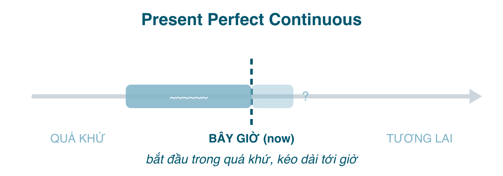

Đây là thì cuối trong nhóm hiện tại và là nơi hai khía cạnh "hoàn thành" và "tiếp diễn" gặp nhau. Hoàn thành cho ta góc nhìn *từ quá khứ tới bây giờ*; tiếp diễn cho ta *quá trình, hành động đang dở*. Cộng lại: **một hành động bắt đầu trong quá khứ, kéo dài liên tục tới bây giờ, và người nói muốn nhấn vào quá trình hoặc độ dài của nó**. Tiếng Việt: "đã ... suốt từ ...", "... bao lâu rồi", "nãy giờ ...".

Tin tốt: học xong bài này là bạn có đủ cả bốn khía cạnh; tám thì còn lại chỉ là dời mốc.

#### Công thức

| | |
|---|---|
| Khẳng định | I/You/We/They **have been working**. He/She/It **has been working**. |
| Phủ định | I **haven't been working**. She **hasn't been working**. |
| Câu hỏi | **Have** you **been working**? **Has** she **been working**? **How long have** you **been waiting**? |

Ba phần, lúc nào cũng đủ ba: <mark>have/has</mark> + <mark>been</mark> + <mark>V-ing</mark>. Lỗi hay gặp là rụng mất <mark>been</mark> (~~I have working~~) hoặc dùng <mark>being</mark> (~~I have being working~~).

#### Khi nào dùng
**1. Hành động bắt đầu trong quá khứ, vẫn đang tiếp tục, nhấn vào "bao lâu rồi".** Với <mark>for, since, how long, all day, all morning</mark>.
- I'**ve been waiting** for you **for an hour**. (Tôi đợi cậu một tiếng rồi, và vẫn đang đợi.)
- She'**s been learning** English **since** she was six. (Cô ấy học tiếng Anh từ hồi sáu tuổi.)
- **How long have** you **been living** in Da Nang? (Sống ở Đà Nẵng bao lâu rồi?)
- It'**s been raining** **all day**. (Mưa cả ngày nay.)

**2. Hành động vừa mới dừng, và dấu vết của nó còn thấy được ở hiện tại.** Không cần nói bao lâu. Người nói giải thích *vì sao* có tình trạng trước mắt.
- Why are you out of breath? **Have** you **been running**? (Sao thở dốc thế? Mới chạy à?)
- Her eyes are red. She'**s been crying**. (Mắt đỏ hoe. Cô ấy khóc.)
- The ground is wet. It'**s been raining**. (Đất ướt. Vừa mưa xong.)
- I'**ve been thinking** about what you said. (Tôi suy nghĩ về điều anh nói mãi.)

Ở nghĩa này, hành động có thể đã kết thúc một vài phút trước, nhưng tiếng Anh vẫn dùng thì hiện tại hoàn thành tiếp diễn vì hậu quả (thở dốc, mắt đỏ, đất ướt) đang ở ngay đây.

**3. Hành động lặp đi lặp lại trong thời gian gần đây,** thường mang sắc thái bực mình hoặc nhận xét.
- He'**s been calling** me all week. (Cả tuần nay anh ta gọi suốt.)
- You'**ve been working** too hard lately. (Dạo này cậu làm nhiều quá.)
- I'**ve been going** to the gym a lot recently.

#### Dấu hiệu nhận biết
<mark>for, since, how long, all day/morning/week, lately, recently, these days</mark>, và những câu có mùi "giải thích hiện trạng" (*You look tired. / Why is the floor wet?*).

#### So sánh với thì dễ nhầm
**Hiện tại hoàn thành tiếp diễn vs. Hiện tại hoàn thành.** Cặp này quan trọng nhất của bài. Có ba tình huống:

*a. Nhấn quá trình vs. nhấn kết quả.*
- I'**ve been reading** that book. (Đang đọc dở, quá trình.)
- I'**ve read** that book. (Đọc xong rồi, kết quả: có thể bàn về nó.)
- She'**s been writing** emails all morning. (Cả sáng ngồi viết email, chưa chắc xong.)
- She'**s written** ten emails this morning. (Viết được mười cái, đếm kết quả.)

Quy tắc kéo theo: **có số lượng** (how many, three times, ten emails) → hiện tại hoàn thành. **Có độ dài** (how long, for two hours, all morning) → hiện tại hoàn thành tiếp diễn. ~~I've been writing ten emails~~ nghe sai tai.

*b. Với <mark>for/since</mark> và động từ hành động: cả hai đều được*, nghĩa gần như nhau, tiếp diễn tự nhiên hơn trong văn nói.
- I'**ve worked** here for five years. = I'**ve been working** here for five years.
- It'**s rained** since Monday. = It'**s been raining** since Monday.

*c. Với động từ trạng thái: chỉ hiện tại hoàn thành.* <mark>know, be, have (sở hữu), like, believe, own</mark> không có V-ing (bài 175).
- I'**ve known** her for years. Không ~~I've been knowing~~.
- We'**ve had** this car since 2020. Không ~~We've been having~~.
- She'**s been** sick for a week. Không ~~She's been being~~.

Chú ý: *live* và *work* nằm giữa: cả *I've lived* và *I've been living* đều đúng.

**Hiện tại hoàn thành tiếp diễn vs. Hiện tại tiếp diễn.** Cả hai đều là "đang". Khác nhau ở chỗ có nói tới thời điểm bắt đầu hay độ dài không:
- I'**m waiting** for the bus. (Đang đợi.)
- I'**ve been waiting** for the bus **for 20 minutes**. (Đợi 20 phút rồi.)

Người Việt dịch "tôi đợi 20 phút rồi" hay cho ra ~~I'm waiting for 20 minutes~~, vì tiếng Việt không đổi gì ngoài thêm "rồi". Tiếng Anh thì đổi hẳn thì. Hễ có <mark>for/since/how long</mark> với nghĩa "tới bây giờ", không dùng hiện tại tiếp diễn.

**Hiện tại hoàn thành tiếp diễn vs. Quá khứ tiếp diễn** (bài 179): *It's been raining* (tới giờ, hoặc vừa dứt, đất còn ướt) vs. *It was raining when I left* (đang mưa vào một thời điểm quá khứ, giờ không liên quan).

#### Lỗi người Việt hay mắc
- **Hiện tại tiếp diễn + for/since**: ~~I'm learning English for 3 years~~ → *I've been learning English for 3 years.*
- **Hiện tại đơn + for/since**: ~~I work here since 2020~~ → *I've been working / I've worked here since 2020.*
- **Rụng <mark>been</mark>**: ~~She has waiting~~ → *She has been waiting.*
- **Động từ trạng thái ở dạng tiếp diễn**: ~~I've been knowing him for years~~ → *I've known him for years.*
- **Dùng khi có số lượng**: ~~I've been visiting Hue three times~~ → *I've visited Hue three times.*
- **Dùng quá khứ đơn cho việc chưa dứt**: ~~I waited for an hour~~ (nói trong lúc vẫn đang đợi) → *I've been waiting for an hour.* (Quá khứ đơn ở đây có nghĩa là đã đợi xong và bỏ đi.)

#### Bài tập
1. I (have been studying / have studied) for three hours and I'm exhausted. → have been studying
2. I (have been reading / have read) 50 pages of this book so far. → have read (có số lượng)
3. You look tired. What (have you been doing / have you done)? → have you been doing
4. She (has been having / has had) that laptop for five years. → has had (have = sở hữu, trạng thái)
5. How long (are you waiting / have you been waiting)? → have you been waiting
6. They (have been building / have built) the bridge. It opens next week. → have built (xong rồi)
7. They (have been building / have built) the bridge for two years and it's still not finished. → have been building
8. Sửa lỗi: *I'm working here since January.* → I've been working here since January.
9. Sửa lỗi: *He has been knowing her for a long time.* → He has known her for a long time.
10. Dịch: "Nãy giờ cậu làm gì mà tay bẩn thế?" → What have you been doing? Your hands are dirty.
11. Dịch: "Tôi học tiếng Nhật được sáu tháng rồi." → I've been learning Japanese for six months.
12. Dịch: "Mưa từ tối qua tới giờ." → It's been raining since last night.

#### Tóm tắt
- <mark>have/has been + V-ing</mark>: hành động từ quá khứ **kéo dài tới giờ**, nhấn **quá trình/độ dài**, hoặc vừa dứt và còn dấu vết.
- Độ dài (how long, for, since, all day) → hoàn thành tiếp diễn. Số lượng (how many, X times) → hoàn thành.
- Động từ trạng thái không bao giờ tiếp diễn: *I've known*, không ~~I've been knowing~~.
- Bốn khía cạnh đã đủ. Bài 178 dời mốc về quá khứ: quá khứ đơn, thì bạn sẽ dùng nhiều nhất khi kể chuyện.
