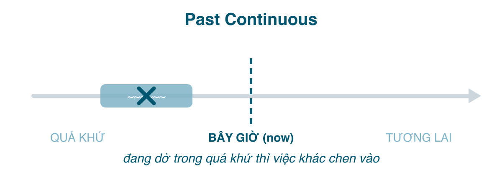

Quá khứ tiếp diễn là hiện tại tiếp diễn (bài 175) dời về quá khứ: một hành động **đang dở vào một thời điểm trong quá khứ**. Nó hiếm khi đứng một mình; nhiệm vụ chính của nó là làm **nền** cho một việc khác xảy ra, hoặc trả lời câu hỏi "lúc đó anh đang làm gì". Tiếng Việt: "đang ... thì ...", "lúc đó đang ...".

#### Công thức

| | |
|---|---|
| Khẳng định | I/He/She/It **was working**. You/We/They **were working**. |
| Phủ định | I **wasn't working**. They **weren't working**. |
| Câu hỏi | **Was** she **working**? **Were** you **working**? What **were** you **doing** at 8? |

Chia <mark>was/were</mark> theo ngôi giống bài 178, V-ing theo quy tắc bài 175.

#### Khi nào dùng
**1. Hành động đang diễn ra tại một thời điểm cụ thể trong quá khứ.** Thời điểm là một giờ, một ngày, hoặc "lúc đó".
- At 8 o'clock last night, I **was having** dinner. (8 giờ tối qua tôi đang ăn tối.)
- This time last year, we **were living** in Hue. (Giờ này năm ngoái nhà tôi đang ở Huế.)
- What **were** you **doing** at 3 pm yesterday? (3 giờ chiều qua anh đang làm gì?)

Hành động đã bắt đầu trước thời điểm đó và còn tiếp tục sau đó; ta chỉ "cắt" một lát ở giữa.

**2. Hành động dài làm nền, bị một hành động ngắn (quá khứ đơn) cắt ngang.** Đây là cách dùng quan trọng nhất, gần như luôn đi với <mark>when</mark> hoặc <mark>while</mark>.
- I **was walking** home **when** it **started** to rain. (Đang đi bộ về thì trời mưa.)
- She **was sleeping** **when** the phone **rang**. (Đang ngủ thì điện thoại reo.)
- **While** we **were having** lunch, the power **went out**. (Đang ăn trưa thì mất điện.)

Nguyên tắc: hành động **dài, đang dở** → quá khứ tiếp diễn; hành động **ngắn, chen vào** → quá khứ đơn. <mark>when</mark> thường đi trước hành động ngắn, <mark>while</mark> đi trước hành động dài.

**3. Hai hành động dài song song.** Cả hai đều tiếp diễn, nối bằng <mark>while</mark>.
- **While** I **was cooking**, he **was watching** TV. (Tôi nấu ăn trong lúc anh ấy xem TV.)
- The kids **were playing** and the adults **were chatting**.

**4. Dựng bối cảnh, không khí khi mở đầu câu chuyện.**
- The sun **was shining** and the birds **were singing**. Then I **got** the phone call. (Nắng đẹp, chim hót. Rồi tôi nhận cuộc gọi.)
- It **was getting** dark and people **were hurrying** home.

**5. Yêu cầu lịch sự, dè dặt** (giống bài 178 mục 6).
- I **was wondering** if you could help me. (Không biết anh giúp tôi được không.)
- I **was hoping** to borrow your car.

**6. Than phiền với <mark>always</mark>**, phiên bản quá khứ của bài 175.
- He **was always leaving** his dirty dishes in the sink.

#### Dấu hiệu nhận biết
<mark>at + giờ + hôm qua/tối qua</mark>, <mark>this time last year</mark>, <mark>when + quá khứ đơn</mark>, <mark>while</mark>, <mark>as</mark>, <mark>all day yesterday</mark>, <mark>at that moment</mark>.

#### So sánh với thì dễ nhầm
**Quá khứ tiếp diễn vs. Quá khứ đơn.** Hai thì này hợp tác nhiều hơn là cạnh tranh, nhưng chọn nhầm thì câu đổi nghĩa:

| Past Continuous | Past Simple |
|---|---|
| đang dở, làm nền, chưa biết có xong không | trọn vẹn, xong, kế tiếp nhau |
| When I arrived, she **was cooking**. (đang nấu dở) | When I arrived, she **cooked**. (tôi tới rồi cô ấy *mới* nấu) |
| I **was reading** a book last night. (đọc dở) | I **read** a book last night. (đọc hết cuốn) |
| He **was dying**. (hấp hối) | He **died**. (đã mất) |

Chuỗi sự kiện nối tiếp nhau *luôn* là quá khứ đơn: *I **got** up, **had** a shower and **left**.* Dùng tiếp diễn cho chuỗi (~~I was getting up, was having a shower...~~) là lỗi hay gặp của người mới học, vì nghĩ "kể chuyện quá khứ là đang".

**Quá khứ tiếp diễn vs. Hiện tại hoàn thành tiếp diễn** (bài 177): *It was raining* (đang mưa vào lúc đó) vs. *It's been raining* (mưa tới giờ, hoặc vừa dứt và còn ướt). Thì đầu đứng trong quá khứ, thì sau nối với hiện tại.

**Quá khứ tiếp diễn vs. Quá khứ hoàn thành tiếp diễn** (bài 181): *When I arrived, they were eating* (đang ăn lúc tôi tới) vs. *When I arrived, they had been eating for an hour* (đã ăn được một tiếng tính tới lúc tôi tới). Thêm độ dài "bao lâu rồi tính tới mốc" thì dùng hoàn thành tiếp diễn.

**Động từ trạng thái** vẫn không chia tiếp diễn: *I **knew** him then* (không ~~was knowing~~), *She **wanted** to leave* (không ~~was wanting~~).

#### Lỗi người Việt hay mắc
- **Tiếp diễn cho hành động ngắn, chen vào**: ~~I was walking home when it was starting to rain~~ → *...when it **started** to rain.*
- **Quá khứ đơn cho cả hai vế khi một vế rõ ràng là nền**: *When the phone rang, I ~~took~~ a shower* nghe như "điện thoại reo rồi tôi đi tắm". Nếu ý là đang tắm thì: *I **was taking** a shower.*
- **Dùng <mark>while</mark> + quá khứ đơn cho hành động ngắn**: ~~While the phone rang, I was taking a shower~~. <mark>while</mark> đi với hành động dài: *While I was taking a shower, the phone rang.*
- **Quên <mark>was/were</mark>**: ~~I walking home when...~~
- **Chia sai <mark>was/were</mark>**: ~~You was~~, ~~They was~~ (hay gặp khi nói nhanh) → *You were, they were.*
- **Dùng cho chuỗi sự kiện**: ~~Yesterday I was waking up at 6, was going to work...~~ → quá khứ đơn hết.

#### Bài tập
1. At 10 pm last night, I (watched / was watching) a film. → was watching
2. I (was walking / walked) to work when I (was seeing / saw) the accident. → was walking, saw
3. While she (cooked / was cooking), the kids (did / were doing) their homework. → was cooking, were doing (hai việc song song)
4. He (fell / was falling) asleep while he (drove / was driving). → fell, was driving
5. Yesterday I (got / was getting) up early, (had / was having) breakfast and (went / was going) to the airport. → got, had, went (chuỗi sự kiện)
6. "What (did you do / were you doing) when I called?" "I (slept / was sleeping)." → were you doing, was sleeping
7. I (didn't know / wasn't knowing) the answer at that time. → didn't know (động từ trạng thái)
8. Sửa lỗi: *When I was arriving, the meeting started.* → When I arrived, the meeting started. (hoặc: When I arrived, the meeting was starting / had started, tùy ý)
9. Sửa lỗi: *They was playing football when it rained.* → They were playing football when it started to rain / when it rained.
10. Dịch: "Lúc đó tôi đang ngủ." → I was sleeping at that time.
11. Dịch: "Tôi đang ăn thì anh ấy gọi." → I was eating when he called.
12. Dịch: "Giờ này năm ngoái tôi đang ở Nhật." → This time last year I was in Japan. (động từ be không cần tiếp diễn; hoặc I was living/travelling in Japan)

#### Tóm tắt
- <mark>was/were + V-ing</mark>: đang dở **tại một thời điểm quá khứ**, làm **nền** cho hành động ngắn (quá khứ đơn) chen vào.
- Hành động dài → tiếp diễn, đi với <mark>while</mark>. Hành động ngắn, chuỗi sự kiện → quá khứ đơn, đi với <mark>when</mark>.
- Động từ trạng thái vẫn là quá khứ đơn: *I knew, she wanted.*
- Bài 180: quá khứ hoàn thành, "quá khứ của quá khứ".
