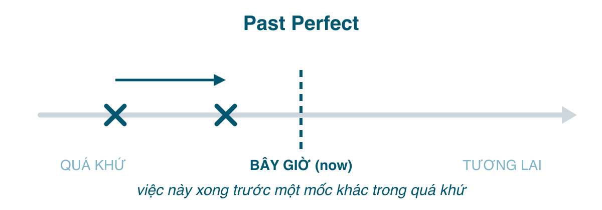

Quá khứ hoàn thành hay được gọi là "quá khứ của quá khứ". Khi câu chuyện đã ở trong quá khứ (quá khứ đơn), và bạn cần nhảy ngược thêm một bước nữa, **về trước mốc đó**, thì dùng <mark>had + V3</mark>. Nó là hiện tại hoàn thành (bài 176) dời mốc "bây giờ" về một điểm trong quá khứ: thay vì "trước bây giờ, còn liên quan tới bây giờ" thì thành "trước lúc đó, còn liên quan tới lúc đó".

Tiếng Việt không có gì tương đương; ta nói "trước đó đã", "rồi mới", hoặc dựa vào thứ tự kể. Vì vậy thì này hiếm khi bị dùng sai, mà thường bị **không dùng** khi cần, hoặc **lạm dụng** cho mọi thứ xa xưa.

#### Công thức

| | |
|---|---|
| Khẳng định | I/You/He/She/It/We/They **had worked** / **had gone**. |
| Phủ định | I **hadn't worked**. |
| Câu hỏi | **Had** you **worked**? **Had** she **left** when you arrived? |

Mọi ngôi đều <mark>had</mark>. Viết tắt: *I'd, you'd, he'd, she'd, we'd, they'd*. Lưu ý <mark>'d</mark> cũng là viết tắt của <mark>would</mark>; nhìn từ sau: *I'd gone* (had + V3), *I'd go* (would + V).

#### Khi nào dùng
**1. Một việc xảy ra trước một việc khác trong quá khứ.** Cần hai sự kiện: sự kiện "sau" ở quá khứ đơn làm mốc, sự kiện "trước" ở quá khứ hoàn thành.
- When I **arrived** at the station, the train **had** already **left**. (Tôi tới ga thì tàu đã chạy rồi.)
- She **didn't want** to see the film because she **had** already **seen** it. (Cô ấy không muốn xem vì đã xem rồi.)
- By the time we **got** there, the shop **had closed**. (Lúc chúng tôi tới nơi thì tiệm đã đóng.)
- I **realised** I **had left** my wallet at home. (Tôi nhận ra là đã để quên ví ở nhà.)

So sánh để thấy nó đổi nghĩa thế nào:
- When I arrived, the train **left**. → tôi tới, *rồi* tàu chạy (kịp hoặc suýt kịp).
- When I arrived, the train **had left**. → tàu chạy *trước khi* tôi tới (lỡ tàu).

**2. Trạng thái hoặc kinh nghiệm tính tới một mốc trong quá khứ.** Với <mark>never, ever, before, by then, until then</mark>.
- Until last year, I **had never been** abroad. (Cho tới năm ngoái tôi chưa từng ra nước ngoài.)
- It **was** the first time she **had driven** a car. (Đó là lần đầu cô ấy lái xe.)
- He **had worked** there for ten years when the company **closed**. (Anh ấy làm được 10 năm thì công ty đóng cửa.)

**3. Giải thích nguyên nhân của một tình trạng trong quá khứ.**
- The ground **was** wet. It **had rained** during the night. (Đất ướt vì đêm qua mưa.)
- He **was** tired because he **hadn't slept** well.

**4. Câu tường thuật (reported speech).** Khi tường thuật lại, quá khứ đơn và hiện tại hoàn thành của lời nói gốc lùi thành quá khứ hoàn thành.
- "I **saw** him." → She said she **had seen** him.
- "I'**ve finished**." → He told me he **had finished**.

**5. Câu điều kiện loại 3 và <mark>wish</mark>**: giả định ngược với quá khứ.
- If I **had known**, I would have called you. (Nếu biết thì tôi đã gọi.)
- I **wish** I **had studied** harder. (Giá mà hồi đó học chăm hơn.)

#### Dấu hiệu nhận biết
<mark>by the time, by then, before, after, already, just, never ... before, until then, when (+ quá khứ đơn)</mark>. Các động từ nhận thức ở quá khứ đơn hay kéo theo quá khứ hoàn thành phía sau: <mark>realised, remembered, found out, discovered, knew, thought</mark> (that) + had V3.

#### So sánh với thì dễ nhầm
**Quá khứ hoàn thành vs. Quá khứ đơn.** Nguyên tắc: **nếu kể đúng thứ tự thời gian, quá khứ đơn là đủ.** Chỉ dùng quá khứ hoàn thành khi thứ tự kể *ngược* với thứ tự xảy ra, hoặc khi cần nhấn mạnh "xong trước".
- I **had** breakfast, then I **went** to work. (Đúng thứ tự: không cần had.)
- I **went** to work after I **had had** breakfast. (Kể ngược; nhưng với <mark>after/before</mark> thì thứ tự đã rõ nên quá khứ đơn cũng được: *after I had breakfast*.)
- When I **got** home, I **found** that someone **had broken** in. (Phải dùng: đột nhập xảy ra trước khi về.)

Người mới học hay đi qua hai giai đoạn: lúc đầu không bao giờ dùng, sau khi học xong thì rải <mark>had</mark> khắp nơi (~~Yesterday I had gone to the market and had bought some fish~~). Hỏi hai câu: có *mốc* quá khứ nào khác không? Việc này có xảy ra *trước* mốc đó không? Thiếu một trong hai thì quay lại quá khứ đơn.

**Quá khứ hoàn thành vs. Hiện tại hoàn thành.** Cùng khía cạnh, khác mốc:
- I'**ve lost** my keys. (Mất, giờ chưa có.)
- I **had lost** my keys, so I couldn't get in **last night**. (Mất trước đó, nên tối qua không vào được.)
- She'**s never eaten** sushi. (Tới giờ chưa.)
- She **had never eaten** sushi before she **moved** to Japan. (Tới lúc chuyển đi Nhật thì chưa.)

Nếu câu đang nói về hiện tại thì không có lý do gì dùng <mark>had</mark>. ~~I had already eaten, I'm not hungry~~ là lỗi; phải là *I've already eaten*.

**Quá khứ hoàn thành vs. Quá khứ hoàn thành tiếp diễn** (bài 181): *He had worked there for ten years when it closed* (nhấn con số, sự kiện) vs. *He had been working there for ten years when it closed* (nhấn quá trình). Với <mark>for</mark> cả hai đều được; với động từ trạng thái chỉ dùng hoàn thành.

#### Lỗi người Việt hay mắc
- **Không dùng khi cần**: *When I arrived, the film ~~started~~* nếu ý là phim đã chiếu được một lúc → *had started.*
- **Lạm dụng cho chuỗi sự kiện**: ~~I had woken up, had brushed my teeth and had left~~ → quá khứ đơn hết.
- **Dùng cho hiện tại**: ~~I had finished my homework, can I go out?~~ → *I've finished.*
- **Quên lùi thì trong tường thuật**: *She said she ~~has seen~~ him* → *had seen.*
- **Dùng V2 thay V3**: ~~had went~~, ~~had took~~ → *had gone, had taken.*
- **Câu điều kiện loại 3 chia sai**: ~~If I knew, I would have called~~ → *If I had known...*

#### Bài tập
1. When I got to the party, most people (left / had left). → had left (đi trước khi tôi tới)
2. I (had / had had) lunch, then I (went / had gone) back to work. → had, went (đúng thứ tự)
3. She told me she (has never seen / had never seen) snow before. → had never seen
4. By the time the ambulance (arrived / had arrived), the man (died / had died). → arrived, had died
5. I (have / had) already eaten, so I'm not hungry now. → have (đang nói về hiện tại)
6. He couldn't pay because he (lost / had lost) his wallet. → had lost
7. If you (told / had told) me earlier, I would have helped. → had told
8. Sửa lỗi: *When I came home, my mother cooked dinner, so we ate right away.* (ý: đã nấu xong) → When I came home, my mother had cooked dinner, so we ate right away.
9. Sửa lỗi: *Yesterday I had gone to the gym and had met Lan.* → Yesterday I went to the gym and met Lan.
10. Dịch: "Tôi đến thì họ đã ăn xong rồi." → When I arrived, they had already finished eating.
11. Dịch: "Cô ấy nói là cô ấy đã gửi email rồi." → She said (that) she had sent the email.
12. Dịch: "Trước năm 2020 tôi chưa từng làm việc từ xa." → Before 2020, I had never worked remotely.

#### Tóm tắt
- <mark>had + V3</mark>: việc xảy ra **trước một mốc khác trong quá khứ**. Cần có mốc đó (thường là quá khứ đơn).
- Kể đúng thứ tự → quá khứ đơn. Kể ngược hoặc nhấn "xong trước" → quá khứ hoàn thành.
- Tường thuật, điều kiện loại 3, <mark>wish</mark> về quá khứ đều dùng thì này.
- Bài 181: quá khứ hoàn thành tiếp diễn, thì ít dùng nhất trong nhóm quá khứ.
