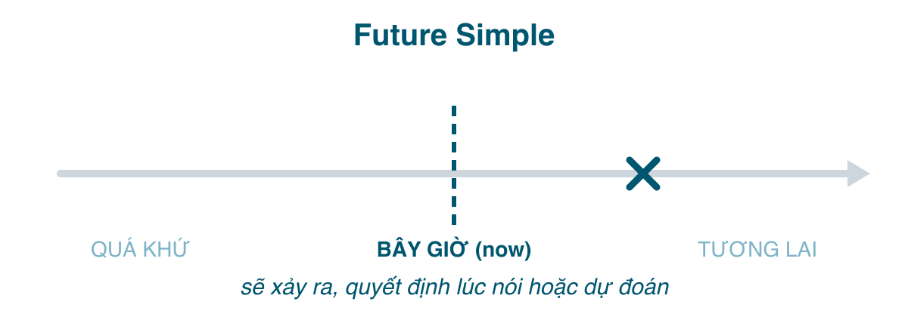

Người Việt học <mark>will</mark> = "sẽ" từ bài đầu tiên, và từ đó mọi câu tương lai đều có <mark>will</mark>. Người bản xứ thì khác: họ nói về tương lai bằng ít nhất bốn cách (<mark>will</mark>, <mark>be going to</mark>, hiện tại tiếp diễn, hiện tại đơn), và <mark>will</mark> không phải cách phổ biến nhất trong hội thoại. Bài này nói về tương lai đơn, nhưng phần lớn thời lượng dành cho câu hỏi thực sự quan trọng: **khi nào dùng <mark>will</mark> và khi nào không**.

#### Công thức

| | |
|---|---|
| Khẳng định | I/You/He/She/It/We/They **will work**. |
| Phủ định | I **won't work**. (= will not) |
| Câu hỏi | **Will** you **work**? **Will** it **rain**? |

Mọi ngôi đều <mark>will</mark> + nguyên mẫu, không <mark>to</mark>, không <mark>-s</mark>. Viết tắt: *I'll, you'll, he'll, she'll, we'll, they'll*. <mark>shall</mark> chỉ còn dùng trong đề nghị với <mark>I/we</mark>: *Shall we go? Shall I open the window?*

#### Khi nào dùng will
**1. Quyết định ngay lúc nói**, không có kế hoạch từ trước. Đây là nghĩa cốt lõi mà sách giáo khoa Việt Nam ít nhấn.
- "The phone's ringing." "I'**ll get** it." (Để tôi nghe.)
- "We're out of milk." "OK, I'**ll buy** some on the way home."
- I think I'**ll have** the chicken. (Gọi món, vừa quyết.)

**2. Dự đoán dựa trên ý kiến, niềm tin**, không có bằng chứng trước mắt. Thường đi với <mark>I think, I'm sure, probably, I expect, I hope</mark>.
- I think Vietnam **will win** tonight. (Tôi nghĩ Việt Nam sẽ thắng.)
- It **will** probably **rain** tomorrow. (Mai chắc mưa.)
- She'**ll be** a great doctor.

**3. Lời hứa, đề nghị giúp, yêu cầu, lời đe dọa, lời từ chối.**
- I **will** always **love** you. (Hứa.)
- I'**ll help** you with the boxes. (Đề nghị.)
- **Will** you **close** the door, please? (Yêu cầu.)
- I **won't tell** anyone. (Hứa không nói.)
- The car **won't start**. (Từ chối, nhân hóa: xe không chịu nổ.)

**4. Sự thật về tương lai, điều chắc chắn sẽ xảy ra.**
- The sun **will rise** at 5:42 tomorrow.
- I'**ll be** 40 next year.

**5. Vế chính của câu điều kiện loại 1** và sau mệnh đề thời gian.
- If it rains, we'**ll stay** home. (Vế <mark>if</mark> dùng hiện tại đơn, bài 174.)
- I'**ll call** you when I get there.

#### will vs. be going to
Đây là so sánh quan trọng nhất bài. <mark>be going to</mark> + nguyên mẫu, chia <mark>am/is/are</mark> theo ngôi.

| | will | be going to |
|---|---|---|
| **Quyết định** | *lúc nói* mới quyết | đã quyết *từ trước*, có ý định |
| | "We've no milk." "I'**ll buy** some." | "Why are you putting on your coat?" "I'**m going to buy** some milk." |
| **Dự đoán** | theo *ý kiến*, cảm giác | theo *bằng chứng* thấy được |
| | I think it'**ll rain** tomorrow. | Look at those clouds. It'**s going to rain**. |
| | He'**ll** probably **pass**. | He hasn't studied at all. He'**s going to fail**. |

Hai câu sau đây cùng dịch là "tôi sẽ học tiếng Nhật", nhưng nghĩa khác:
- I'**ll learn** Japanese. (Vừa nảy ra, kiểu "ừ nhỉ, để tôi học".)
- I'**m going to learn** Japanese. (Đã tính rồi, có thể đã tìm lớp.)

Khi ai đó hỏi về kế hoạch của bạn (*What are you going to do this summer?*), trả lời bằng <mark>will</mark> nghe như bạn chưa hề nghĩ tới. Trong văn nói, <mark>be going to</mark> đọc nhanh thành *gonna*; hiểu được là đủ, viết thì đừng.

#### Bốn cách nói tương lai, xếp theo mức "chắc"
1. **Hiện tại đơn**: lịch trình cố định, thời gian biểu. *The train **leaves** at 6.* (bài 174)
2. **Hiện tại tiếp diễn**: sắp xếp đã chốt với người khác, có thời gian. *I'**m meeting** Linh at 7.* (bài 175)
3. **be going to**: ý định cá nhân, hoặc dự đoán có bằng chứng. *I'**m going to meet** Linh soon.*
4. **will**: quyết định tức thì, dự đoán theo ý kiến, hứa hẹn. *I'**ll meet** Linh sometime.*

Hiện tại tiếp diễn và <mark>be going to</mark> gần nhau và nhiều khi thay nhau được. Khác biệt nhỏ: tiếp diễn nhấn *đã sắp xếp* (có hẹn, có vé), <mark>be going to</mark> nhấn *ý định*. Với dự đoán chỉ dùng <mark>be going to</mark>: ~~It's raining tomorrow~~ sai, *It's going to rain tomorrow* đúng.

#### Dấu hiệu nhận biết
<mark>tomorrow, next week/month/year, in 2030, soon, in a few days, tonight, later</mark>, và với <mark>will</mark> nói riêng: <mark>I think, I'm sure, probably, perhaps, I promise, I hope</mark>.

#### So sánh với các thì khác
**Tương lai đơn vs. Hiện tại đơn cho tương lai.** Lịch trình bên ngoài (tàu, lớp, phim) dùng hiện tại đơn; ý định hoặc lời hứa của người nói dùng <mark>will</mark>.
- The meeting **starts** at 9. (Lịch.) / I'**ll be** there at 9. (Tôi hứa.)
- Và tuyệt đối không <mark>will</mark> sau <mark>when, if, until, as soon as, before, after</mark>: *I'll text you when I **arrive**.*

**Tương lai đơn vs. Tương lai tiếp diễn** (bài 183): *I'll work tomorrow* (quyết định/dự đoán) vs. *I'll be working at 9 tomorrow* (vào lúc 9 giờ đang làm dở).

**Tương lai đơn vs. Tương lai hoàn thành** (bài 184): *I'll finish the report tomorrow* vs. *I'll have finished the report by tomorrow* (xong trước hạn).

#### Lỗi người Việt hay mắc
- **<mark>will</mark> cho mọi câu tương lai.** Lỗi không sai ngữ pháp, nhưng khiến bạn nghe như chưa bao giờ có kế hoạch gì. Hỏi mình: đã quyết chưa? Đã sắp xếp chưa? Có bằng chứng không? Có thì không dùng <mark>will</mark>.
- **<mark>will</mark> sau <mark>when/if</mark>**: ~~When I will have time, I'll call you~~ → *When I have time...*
- **<mark>will</mark> + <mark>to</mark>** hoặc **+ <mark>-s</mark>**: ~~She will to go~~, ~~He will goes~~ → *She will go. He will go.*
- **Thiếu <mark>be</mark> trong <mark>be going to</mark>**: ~~I going to study~~ → *I'm going to study.*
- **<mark>be going to</mark> + <mark>go</mark>** bị lược sai: *I'm going to go to the market* đúng tuy hơi lủng củng; *I'm going to the market* (hiện tại tiếp diễn) gọn hơn. Nhưng ~~I'm going to the market tomorrow at 5 maybe~~ thì mâu thuẫn: tiếp diễn là đã chốt, "maybe" là chưa.
- **Dịch "sẽ" trong câu kể chuyện quá khứ thành <mark>will</mark>**: "Anh ấy nói anh ấy sẽ đến" → ~~He said he will come~~ → *He said he **would** come.* (<mark>would</mark> là quá khứ của <mark>will</mark>.)

#### Bài tập
1. "It's cold in here." "I (will close / am going to close) the window." → will close (quyết định tức thì)
2. "Why are you buying flour?" "I (will make / am going to make) a cake." → am going to make (ý định có sẵn)
3. Look at the sky! It (will / is going to) rain. → is going to (bằng chứng)
4. I think the party (will be / is being) fun. → will be (ý kiến)
5. The plane (will take off / takes off) at 10:40. → takes off (lịch trình; "will take off" không sai nhưng kém tự nhiên)
6. I'll email you as soon as I (get / will get) the results. → get
7. I (am meeting / will meet) the dentist at 3 tomorrow; it's booked. → am meeting
8. Sửa lỗi: *She will to call you tonight.* → She will call you tonight.
9. Sửa lỗi: *If it will rain, we will cancel the trip.* → If it rains, we will cancel the trip.
10. Dịch: "Để tôi giúp anh." → I'll help you.
11. Dịch: "Hè này tôi định học bơi." → I'm going to learn to swim this summer.
12. Dịch: "Anh ấy hứa là sẽ không nói ai." → He promised (that) he wouldn't tell anyone.

#### Tóm tắt
- <mark>will + V</mark>: quyết định *tại chỗ*, dự đoán *theo ý kiến*, hứa hẹn, đề nghị, sự thật tương lai, vế chính điều kiện loại 1.
- <mark>be going to</mark>: ý định *có sẵn*, dự đoán *có bằng chứng*. Hiện tại tiếp diễn: sắp xếp đã chốt. Hiện tại đơn: lịch trình.
- Không <mark>will</mark> sau <mark>when/if/until</mark>. Quá khứ của <mark>will</mark> là <mark>would</mark>.
- Bài 183: tương lai tiếp diễn, và cách dùng nó để hỏi han cho lịch sự.
