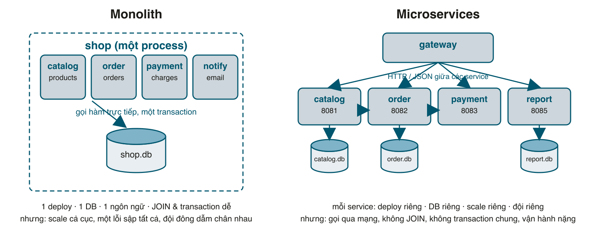

Microservices là từ bị lạm dụng nhiều nhất trong ngành này. Người ta tách monolith ra 20 service vì "Netflix làm vậy", rồi một năm sau có 20 chỗ để deploy, 20 chỗ để debug, và một đơn hàng đi qua 6 service mà không ai biết nó chết ở đâu. Ngược lại, cũng có đội kẹt với một app Rails 500 nghìn dòng mà mỗi lần deploy phải đi họp. Series này trả lời hai câu hỏi: **microservices hơn và kém monolith ở chỗ nào**, và **phải làm gì thì mới thật sự nhận được cái "hơn" đó**. Mỗi lợi ích đều có điều kiện kèm theo; bỏ điều kiện thì chỉ còn lại chi phí.

Để không nói suông, series xây một shop nhỏ: sản phẩm, đơn hàng, thanh toán, email. Bài này viết nó dưới dạng **monolith**, các bài sau tách dần ra, và mỗi lần tách là một lần thấy rõ được gì, mất gì. Code viết bằng Ruby với **Sinatra** thay vì Rails: mỗi service chỉ là một file 50 - 80 dòng, mở 5 terminal là chạy được 5 service, không cần Docker hay Kubernetes để học. Mọi thứ trong series chuyển sang Rails API mode đều được: route của Sinatra là action của controller, module là service object, phần còn lại y nguyên.

Series gồm:
1. Monolith vs Microservices, ưu và nhược điểm, xây monolith làm mốc so sánh (bài này).
2. Tách service, database riêng, giao tiếp HTTP và saga.
3. Giao tiếp bất đồng bộ với event và outbox.
4. API gateway, timeout, retry, circuit breaker và request id.
5. Scale, deploy độc lập, contract giữa các service và Docker Compose.

#### Monolith là gì
Monolith là **một chương trình**: một codebase, build ra một thứ, deploy một thứ, nói chuyện với một database. App Rails của bạn gần như chắc chắn là monolith. Bên trong có thể chia module rất đẹp, nhưng lúc chạy chỉ có một process (hay nhiều process giống hệt nhau sau Puma), module này gọi module kia bằng **lời gọi hàm**.



Điểm mạnh của monolith nằm ở chữ "một":
- **Một transaction**: tạo đơn hàng, trừ kho, lưu thanh toán trong một <mark>ActiveRecord::Base.transaction</mark>. Lỗi ở bước nào thì rollback tất cả, không phải nghĩ gì.
- **Một database**: muốn báo cáo doanh thu theo sản phẩm thì <mark>JOIN</mark> hai bảng, xong.
- **Một lần deploy**, một bộ log, một chỗ đặt <mark>binding.irb</mark>, một <mark>docker compose up</mark>.
- **Refactor dễ**: đổi tên method, tìm và sửa hết mọi chỗ gọi trong một repo. Chuyển một đoạn code từ module này sang module kia là chuyện 10 phút.

Và điểm yếu cũng nằm ở chữ "một":
- **Scale cả cục**: trang danh sách sản phẩm chịu 95% lưu lượng nhưng muốn thêm máy thì phải nhân bản cả phần thanh toán, cả phần gửi email.
- **Một lỗi kéo sập tất cả**: một memory leak trong module xuất báo cáo làm chết luôn chức năng đặt hàng.
- **Deploy chung**: đội catalog sửa xong muốn lên production phải chờ đội payment sửa xong bug của họ. Đội càng đông, hàng chờ càng dài.
- **Một ngôn ngữ, một phiên bản framework**: muốn nâng Rails 6 lên 7 là nâng cả app một lúc.

Cần nói rõ: 4 điểm yếu này chỉ **đau khi app đủ lớn**. Một đội 5 người với app 50 nghìn dòng hầu như không gặp cái nào.

#### Microservices là gì
Microservices là **nhiều chương trình**, mỗi chương trình phụ trách một mảng nghiệp vụ (catalog, order, payment...), có **database riêng**, **deploy riêng**, và nói chuyện với nhau **qua mạng** (HTTP, gRPC, message broker). Không có process nào "là cả hệ thống"; hệ thống là tổng của các service cộng với cách chúng nói chuyện.

Hai chữ quan trọng nhất của định nghĩa trên là **database riêng** và **qua mạng**. Nhiều service dùng chung một database thì không phải microservices, đó là một monolith bị cắt thành nhiều process, nhận đủ nhược điểm của cả hai bên. Còn "qua mạng" là nguồn gốc của gần như mọi khó khăn: mạng chậm, mạng đứt, service kia đang restart, và không có transaction nào bao trùm được hai service.

#### So sánh

| | Monolith | Microservices |
|---|---|---|
| Deploy | Cả app, mọi đội cùng chờ | Từng service, đội nào xong đội đó lên |
| Scale | Nhân bản cả app | Nhân bản đúng service đang quá tải |
| Lỗi | Một chỗ hỏng có thể sập cả app | Khoanh vùng được, nếu có timeout và circuit breaker (bài 4) |
| Công nghệ | Một ngôn ngữ, một phiên bản | Mỗi service tự chọn, nâng cấp từng cái |
| Đội | Đông người là dẫm chân | Mỗi đội sở hữu vài service |
| Transaction | ACID, rollback tự động | Không có; phải tự bù trừ (saga, bài 2) |
| Truy vấn | JOIN thoải mái | Không JOIN qua service; ghép bằng API hoặc nhân bản dữ liệu (bài 3) |
| Gọi nhau | Gọi method, micro giây, không bao giờ lỗi | Gọi mạng, mili giây, có thể lỗi bất cứ lúc nào |
| Debug | Một log, một stack trace | Log rải khắp nơi, cần request id (bài 4) |
| Refactor ranh giới | Đổi chỗ code là xong | Đổi API là ảnh hưởng người khác, cần versioning (bài 5) |
| Vận hành | Một thứ để chạy | N thứ để chạy, gateway, health check, CI cho từng cái |
| Test tích hợp | Chạy một process | Phải dựng nhiều service, hoặc fake từng cái |

Đọc kỹ cột phải sẽ thấy: **mọi ưu điểm của microservices đều có chữ "nếu"**. Deploy độc lập nếu API giữa các service ổn định. Khoanh vùng lỗi nếu có timeout và breaker. Scale riêng nếu service không giữ trạng thái trong bộ nhớ. Bỏ chữ "nếu" đi, bạn có một hệ thống phân tán với toàn nhược điểm.

#### Lợi ích nào cần điều kiện gì
Đây là bảng quan trọng nhất series, các bài sau chỉ là làm từng dòng của nó:

| Lợi ích muốn có | Điều kiện phải làm | Bài |
|---|---|---|
| Deploy service A không ảnh hưởng B | Ranh giới đúng nghiệp vụ, DB riêng, API chỉ thêm không bớt | 2, 5 |
| Dữ liệu vẫn đúng dù không có transaction chung | Saga với bước bù trừ, outbox, consumer idempotent | 2, 3 |
| Thêm tính năng mới không sửa service cũ | Giao tiếp bằng event, service mới tự đọc event | 3 |
| Service B sập không kéo A sập theo | Timeout, retry có chọn lọc, circuit breaker | 4 |
| Debug được một request đi qua 5 service | Request id chuyền qua mọi hop, log có tên service | 4 |
| Scale riêng service đang nóng | Service không giữ state, nhiều instance dùng chung DB của nó, gateway chia tải | 5 |
| Deploy không gián đoạn | Nhiều instance, gateway bỏ qua instance đang tắt | 5 |

#### Khi nào nên, khi nào không
Kinh nghiệm của tôi, tính theo thứ tự quan trọng:
- **Đội dưới 10 lập trình viên: đừng.** Microservices giải quyết vấn đề của tổ chức (nhiều đội dẫm chân nhau) nhiều hơn vấn đề kỹ thuật. Đội nhỏ không có vấn đề đó, chỉ nhận chi phí.
- **Chưa hiểu rõ nghiệp vụ: đừng.** Ranh giới service sai thì sửa cực kỳ đắt (đổi API, chuyển dữ liệu giữa hai database). Trong monolith, chuyển một bảng sang module khác chỉ là một migration. Hãy làm **modular monolith** trước: chia namespace theo nghiệp vụ, cấm namespace này đọc bảng của namespace kia (gem <mark>packwerk</mark> làm việc này cho Rails), rồi tách khi ranh giới đã ổn định 6 tháng.
- **Chưa có CI/CD, log tập trung, metrics (bài 071 - 074): đừng.** Một monolith thiếu monitoring còn sống được nhờ nhìn một log. 8 service thiếu monitoring là mù.
- **Nên** khi: nhiều đội cần deploy độc lập; một phần hệ thống có tải hoặc yêu cầu khác hẳn phần còn lại (ví dụ xử lý video bài 126 so với CRUD); một phần cần ngôn ngữ khác (ML bằng Python cạnh app Rails); hoặc đã có monolith và đang đau thật ở những điểm kể trên.

Và một con đường giữa, hay được dùng nhất trong thực tế: monolith + **tách đúng một hay hai service** cho phần thật sự khác biệt. App Rails gọi sang một service nhỏ xử lý ảnh. Không cần "chuyển sang microservices" toàn bộ để hưởng lợi.

#### Xây monolith để làm mốc
Toàn bộ series dùng một shop với 4 nghiệp vụ: **catalog** (sản phẩm, tồn kho), **order** (đơn hàng), **payment** (thu tiền, giả lập), **notify** (email, giả lập bằng log). Bài này viết nó thành một chương trình, **nhưng chia module theo nghiệp vụ ngay từ đầu**, để các bài sau tách ra mà không phải viết lại.

Phiên bản dùng trong series: Ruby 3.2, Sinatra 4.2, Puma 6.6, gem <mark>sqlite3</mark> 2.10. Tôi dùng SQLite thay cho PostgreSQL để bạn chạy được ngay không cần cài gì; mọi ý tưởng về database trong series áp dụng y nguyên cho PostgreSQL.
```ruby
# Gemfile
source "https://rubygems.org"

gem "sinatra", "~> 4.1"
gem "rackup", "~> 2.2"
gem "puma", "~> 6.5"
gem "sqlite3", "~> 2.3"
```
```sh
mkdir shop && cd shop
# tạo Gemfile như trên
bundle install
```

Cấu trúc:
```
shop/
├── monolith.rb          # một process, một cổng 8080
└── lib/
    ├── db.rb            # mở SQLite, tạo bảng
    ├── web.rb           # log và helper JSON dùng chung
    ├── catalog.rb       # sản phẩm, tồn kho
    ├── order.rb         # tạo đơn hàng
    ├── payment.rb       # cổng thanh toán giả
    └── notify.rb        # gửi email giả
```

Phần mở database. Puma chạy nhiều thread, và một kết nối SQLite không nên bị hai thread dùng cùng lúc, nên mỗi thread được cấp một kết nối riêng qua <mark>Thread.current</mark>. ActiveRecord làm đúng việc này với connection pool của nó:
```ruby
# lib/db.rb
# DB mở một file SQLite, chạy câu lệnh tạo bảng, và cấp cho MỖI THREAD một kết nối riêng
# (Puma chạy nhiều thread; một kết nối SQLite không nên bị hai thread dùng cùng lúc).
require "sqlite3"

class DB
  def initialize(path, schema)
    @path = path
    @key = "db:#{path}:#{object_id}"
    connection.execute_batch(schema)
  end

  def connection
    Thread.current[@key] ||= SQLite3::Database.new(@path).tap do |c|
      c.busy_timeout = 5000               # chờ tối đa 5 giây khi file đang bị khóa
      c.execute("PRAGMA journal_mode = WAL")
      c.execute("PRAGMA foreign_keys = ON")
      c.results_as_hash = true
    end
  end

  # Những hàm hay dùng, chuyển thẳng sang kết nối của thread hiện tại.
  %i[execute get_first_row get_first_value transaction last_insert_row_id changes].each do |m|
    define_method(m) { |*args, &blk| connection.public_send(m, *args, &blk) }
  end
end
```

Vài thứ dùng chung cho mọi service: log dạng <mark>key=value</mark> (dễ grep, dễ gom về một chỗ) và helper JSON cho Sinatra:
```ruby
# lib/web.rb
# Vài thứ dùng chung cho mọi service: log dạng key=value, helper JSON cho Sinatra.
require "json"
require "logger"

module Log
  $stdout.sync = true
  LOGGER = Logger.new($stdout)
  LOGGER.formatter = ->(level, time, _prog, msg) { "time=#{time.strftime('%H:%M:%S.%L')} level=#{level} #{msg}\n" }

  def self.service=(name)
    @service = name
  end

  # Log.info("request", method: "GET", path: "/products") -> msg=request service=catalog method=GET path=/products
  %i[info warn error].each do |level|
    define_singleton_method(level) do |msg, **kv|
      fields = { msg: msg, service: @service }.merge(kv).map { |k, v| "#{k}=#{v.to_s =~ /[\s"]/ ? v.to_s.inspect : v}" }
      LOGGER.public_send(level, fields.join(" "))
    end
  end
end

module Web
  module Helpers
    def json_body(status, obj)
      content_type :json
      halt status, JSON.generate(obj)
    end

    def json_error(status, msg)
      json_body status, error: msg
    end

    # Đọc JSON từ body; sai định dạng thì trả 400 luôn.
    def read_json
      JSON.parse(request.body.read)
    rescue JSON::ParserError => e
      json_error 400, "JSON sai: #{e.message}"
    end
  end

  # Middleware ghi một dòng log cho mỗi request.
  class RequestLog
    def initialize(app) = @app = app

    def call(env)
      start = Process.clock_gettime(Process::CLOCK_MONOTONIC)
      status, headers, body = @app.call(env)
      ms = ((Process.clock_gettime(Process::CLOCK_MONOTONIC) - start) * 1000).round
      Log.info("request", method: env["REQUEST_METHOD"], path: env["PATH_INFO"], status: status, ms: ms)
      [status, headers, body]
    end
  end
end
```

Catalog: sản phẩm và tồn kho. Mọi hàm nhận <mark>db</mark> làm tham số, nên **module order có thể gọi catalog bên trong transaction của mình**. Đây chính là thứ sẽ mất khi tách service.
```ruby
# lib/catalog.rb
# Catalog: sản phẩm và tồn kho.
module Catalog
  SCHEMA = <<~SQL
    CREATE TABLE IF NOT EXISTS products (
      id    INTEGER PRIMARY KEY,
      name  TEXT    NOT NULL,
      price INTEGER NOT NULL,
      stock INTEGER NOT NULL CHECK (stock >= 0)
    );
  SQL

  class NotFound < StandardError; end
  class OutOfStock < StandardError; end

  # Thêm vài sản phẩm mẫu nếu bảng đang trống.
  def self.seed(db)
    return if db.get_first_value("SELECT count(*) FROM products") > 0

    db.execute(<<~SQL)
      INSERT INTO products (name, price, stock) VALUES
        ('Bàn phím cơ', 1200000, 10), ('Chuột không dây', 450000, 5), ('Tai nghe', 2500000, 2)
    SQL
  end

  def self.list(db)
    db.execute("SELECT id, name, price, stock FROM products ORDER BY id")
  end

  def self.get(db, id)
    db.get_first_row("SELECT id, name, price, stock FROM products WHERE id = ?", id) or
      raise NotFound, "không có sản phẩm"
  end

  # Trừ tồn kho bằng MỘT câu UPDATE có điều kiện: hai người cùng mua món cuối thì chỉ một người được.
  def self.reserve(db, id, qty)
    db.execute("UPDATE products SET stock = stock - ? WHERE id = ? AND stock >= ?", [qty, id, qty])
    return if db.changes == 1

    get(db, id) # không có sản phẩm thì raise NotFound
    raise OutOfStock, "hết hàng"
  end
end
```
<mark>reserve</mark> trừ kho bằng một câu <mark>UPDATE ... WHERE stock >= ?</mark>, là cách chống overselling của bài 081: hai người cùng mua món cuối thì chỉ một <mark>UPDATE</mark> có <mark>changes == 1</mark>.

Payment giả lập: thẻ bắt đầu bằng <mark>4000</mark> bị từ chối, còn lại được:
```ruby
# lib/payment.rb
# Payment giả lập cổng thanh toán: thẻ 4242 luôn được, thẻ 4000 luôn bị từ chối.
module Payment
  class Declined < StandardError; end

  # Trừ tiền trên thẻ. Thật ra chỉ nhìn 4 số đầu để quyết định.
  def self.charge(card, amount)
    raise Declined, "thẻ bị từ chối" if card.start_with?("4000")

    { "id" => format("ch_%06d", rand(1_000_000)), "amount" => amount }
  end
end
```

Notify giả lập:
```ruby
# lib/notify.rb
# Notify "gửi email" bằng cách ghi log. Đủ cho demo.
module Notify
  def self.order_paid(order)
    Log.info("gửi email", to: order["email"], subject: "Đơn hàng đã thanh toán", order: order["id"], total: order["total"])
  end
end
```

Và order, trái tim của shop. Đọc kỹ method <mark>create</mark>:
```ruby
# lib/order.rb
# Order tạo đơn hàng: kiểm tra giá và tồn kho, thu tiền, lưu đơn. Tất cả trong MỘT transaction.
require_relative "catalog"
require_relative "payment"
require_relative "notify"

module Order
  SCHEMA = <<~SQL
    CREATE TABLE IF NOT EXISTS orders (
      id         INTEGER PRIMARY KEY,
      product_id INTEGER NOT NULL,
      qty        INTEGER NOT NULL,
      total      INTEGER NOT NULL,
      email      TEXT    NOT NULL,
      status     TEXT    NOT NULL,
      charge_id  TEXT
    );
  SQL

  class NotFound < StandardError; end
  class Invalid < StandardError; end

  class Service
    def initialize(db) = @db = db

    # Mọi bước nằm trong một transaction: bước nào lỗi thì rollback,
    # tồn kho tự quay về như cũ, không cần dọn dẹp gì.
    def create(product_id:, qty:, email:, card:)
      raise Invalid, "thiếu qty, email hoặc card" if qty.to_i <= 0 || email.to_s.empty? || card.to_s.empty?

      order = @db.transaction do
        product = Catalog.get(@db, product_id)
        Catalog.reserve(@db, product["id"], qty)
        total = product["price"] * qty
        charge = Payment.charge(card, total) # raise Declined -> rollback: tồn kho vừa trừ được trả lại
        @db.execute(
          "INSERT INTO orders (product_id, qty, total, email, status, charge_id) VALUES (?, ?, ?, ?, 'paid', ?)",
          [product["id"], qty, total, email, charge["id"]]
        )
        get(@db.last_insert_row_id)
      end
      Notify.order_paid(order)
      order
    end

    def get(id)
      @db.get_first_row("SELECT * FROM orders WHERE id = ?", id) or raise NotFound, "không có đơn hàng"
    end

    # Loại truy vấn monolith làm rất dễ: JOIN hai bảng của hai module.
    def report
      @db.execute(<<~SQL)
        SELECT p.name AS product, count(o.id) AS orders, coalesce(sum(o.total), 0) AS revenue
        FROM products p LEFT JOIN orders o ON o.product_id = p.id AND o.status = 'paid'
        GROUP BY p.id ORDER BY p.id
      SQL
    end
  end
end
```
Bốn bước (lấy giá, trừ kho, thu tiền, lưu đơn) nằm trong **một transaction**. Thẻ bị từ chối ở bước 3 thì <mark>Payment::Declined</mark> bay ra khỏi block, gem sqlite3 rollback, tồn kho vừa trừ ở bước 2 **tự quay lại**. Không có code dọn dẹp nào. Hãy nhớ cảm giác này, bài sau sẽ thấy nó đắt thế nào.

Method <mark>report</mark> cũng đáng chú ý: một câu <mark>JOIN</mark> giữa bảng <mark>products</mark> (của catalog) và <mark>orders</mark> (của order). Trong monolith đây là chuyện hiển nhiên.

Cuối cùng là app Sinatra, nối tất cả vào một cổng:
```ruby
# monolith.rb
# Monolith: một process, một database, một cổng. Chạy: ruby monolith.rb
require "sinatra"
require_relative "lib/db"
require_relative "lib/web"
require_relative "lib/order"

Log.service = "monolith"
set :server, :puma
set :port, 8080
set :logging, false
set :show_exceptions, :after_handler # để các khối error bên dưới được chạy
use Web::RequestLog
helpers Web::Helpers

DBH = DB.new("shop.db", Catalog::SCHEMA + Order::SCHEMA)
Catalog.seed(DBH)
ORDERS = Order::Service.new(DBH)

get "/products" do
  json_body 200, Catalog.list(DBH)
end

post "/orders" do
  input = read_json
  order = ORDERS.create(product_id: input["product_id"], qty: input["qty"], email: input["email"], card: input["card"])
  json_body 201, order
end

get "/orders/:id" do
  json_body 200, ORDERS.get(params[:id])
end

get "/report" do
  json_body 200, ORDERS.report
end

error Order::Invalid do json_error 400, env["sinatra.error"].message end
error Catalog::NotFound, Order::NotFound do json_error 404, env["sinatra.error"].message end
error Catalog::OutOfStock, Payment::Declined do json_error 422, env["sinatra.error"].message end
```
Ba khối <mark>error</mark> ở cuối đổi exception của từng module thành status code: 400, 404, 422. Trong Rails, đó là <mark>rescue_from</mark> trong <mark>ApplicationController</mark>.

Chạy thử:
```sh
bundle exec ruby monolith.rb
# == Sinatra (v4.2.1) has taken the stage on 8080 for development with backup from Puma
```
Terminal thứ hai:
```sh
curl -s localhost:8080/products
# [{"id":1,"name":"Bàn phím cơ","price":1200000,"stock":10},{"id":2,"name":"Chuột không dây","price":450000,"stock":5},{"id":3,"name":"Tai nghe","price":2500000,"stock":2}]

curl -s -X POST localhost:8080/orders -H 'Content-Type: application/json' \
  -d '{"product_id":1,"qty":2,"email":"an@example.com","card":"4242424242424242"}'
# {"id":1,"product_id":1,"qty":2,"total":2400000,"email":"an@example.com","status":"paid","charge_id":"ch_563382"}

curl -s -X POST localhost:8080/orders -H 'Content-Type: application/json' \
  -d '{"product_id":3,"qty":1,"email":"an@example.com","card":"4000000000000002"}'
# {"error":"thẻ bị từ chối"}

curl -s -X POST localhost:8080/orders -H 'Content-Type: application/json' \
  -d '{"product_id":3,"qty":5,"email":"an@example.com","card":"4242424242424242"}'
# {"error":"hết hàng"}

curl -s localhost:8080/products
# [{"id":1,"name":"Bàn phím cơ","price":1200000,"stock":8},{"id":2,...,"stock":5},{"id":3,...,"stock":2}]

curl -s localhost:8080/report
# [{"product":"Bàn phím cơ","orders":1,"revenue":2400000},{"product":"Chuột không dây","orders":0,"revenue":0},{"product":"Tai nghe","orders":0,"revenue":0}]
```
Tồn kho của Tai nghe vẫn là 2 sau khi thẻ bị từ chối: transaction đã rollback. Log phía server:
```
time=11:12:17.678 level=INFO msg="gửi email" service=monolith to=an@example.com subject="Đơn hàng đã thanh toán" order=1 total=2400000
time=11:12:17.678 level=INFO msg=request service=monolith method=POST path=/orders status=201 ms=5
time=11:12:17.690 level=INFO msg=request service=monolith method=POST path=/orders status=422 ms=1
```
Hãy nhìn con số <mark>ms=5</mark>: bốn bước nghiệp vụ, hai bảng, một email, năm mili giây. Mạng không tham gia vào đâu cả.

#### Monolith này đã "modular" ở chỗ nào
Nếu nhìn kỹ, các module không hề đụng vào bảng của nhau: <mark>Order</mark> không viết SQL lên bảng <mark>products</mark>, nó gọi <mark>Catalog.reserve</mark>. <mark>Payment</mark> không biết đơn hàng là gì, chỉ nhận số tiền. Ranh giới này là thứ **bạn nên có trong mọi monolith**, kể cả khi không bao giờ tách: code dễ đọc hơn, test dễ hơn, và nếu có ngày tách thì bạn tách theo đúng đường này. Ngoại lệ duy nhất là method <mark>report</mark> với câu JOIN, tôi cố tình để lại để bài sau có cái mà mất.

Trong Rails, tương đương là: mỗi nghiệp vụ một namespace (<mark>Catalog::Product</mark>, <mark>Orders::Order</mark>), <mark>packwerk</mark> để cấm namespace này gọi thẳng model của namespace kia, và các điểm gọi chéo đi qua một service object. Bài 099 (DDD trong Rails) đã làm việc này.

#### Mẹo và lỗi hay gặp
- "Microservices" không có kích thước chuẩn. Tách theo **nghiệp vụ** (bounded context, bài 095), không theo bảng, không theo tầng (một "service DB", một "service API" là sai hoàn toàn).
- Hai service dùng chung một database là lỗi phổ biến nhất khi mới tách. Ai cũng sửa schema được thì không ai deploy độc lập được.
- Đừng đánh giá monolith qua kích thước code. Shopify, GitHub, Basecamp chạy monolith Rails hàng triệu dòng. Thứ làm monolith khó sống là **ranh giới bên trong bị mục**, không phải số dòng.
- Khi so sánh hai kiến trúc, hãy so sánh **chi phí vận hành** chứ không chỉ chi phí viết code. Viết 5 service mất một tuần; chạy 5 service tử tế trong hai năm mới là phần khó.
- Sinatra ở chế độ development hiện trang HTML backtrace thay vì chạy khối <mark>error</mark>; dòng <mark>set :show_exceptions, :after_handler</mark> là để handler của mình được ưu tiên. Thiếu nó bạn sẽ tưởng handler không chạy.

#### Checklist
- Nêu được 4 điểm mạnh của monolith (một transaction, một DB, một deploy, refactor dễ) và 4 điểm yếu (scale cả cục, lỗi lan, deploy chung, một công nghệ).
- Nêu được "điều kiện" đi kèm mỗi lợi ích của microservices trong bảng ở trên.
- <mark>bundle exec ruby monolith.rb</mark> chạy; tạo đơn với thẻ 4242 được, thẻ 4000 bị từ chối và tồn kho **không đổi**.
- Chỉ ra được chỗ duy nhất trong code đã "vượt ranh giới" module (câu JOIN trong <mark>report</mark>).

#### Bài tập thêm
1. Thêm module <mark>User</mark> với bảng <mark>users</mark> và cho đơn hàng tham chiếu <mark>user_id</mark>. Bạn sẽ chọn gì: <mark>Order</mark> gọi <mark>User.get</mark>, hay JOIN thẳng? Giải thích lý do.
2. Viết test (minitest hoặc RSpec) cho <mark>Order::Service#create</mark> với trường hợp thẻ bị từ chối, kiểm tra tồn kho không đổi.
3. Lấy một dự án bạn đang làm, liệt kê các "nghiệp vụ" trong đó và vẽ mũi tên ai gọi ai. Nếu có mũi tên hai chiều giữa hai nghiệp vụ, đó là chỗ tách sẽ đau nhất.

Mã nguồn cuối bài: [post_164.zip](/assets/code/post_164.zip)
