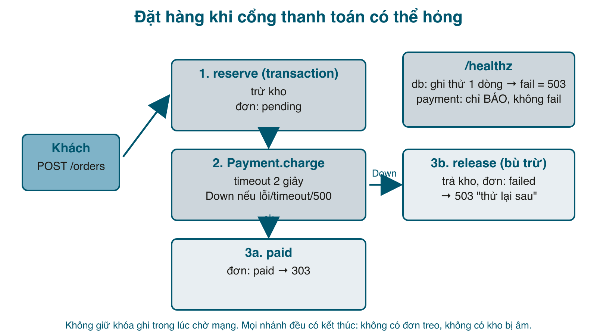

Bốn bài trước test hệ thống khi mọi thứ xung quanh nó bình thường. Bài cuối test **khi xung quanh hỏng**: cổng thanh toán trả lỗi, cổng thanh toán treo, process bị giết, file DB không ghi được, và chuyện hỏng nặng nhất là mất dữ liệu phải lấy từ backup. Những tình huống này đều tái hiện được trên máy mình, đều viết thành test được, và đều rẻ hơn nhiều so với lần đầu gặp chúng trên production lúc 2 giờ sáng.



#### Cho app một thứ để hỏng
Shop tới giờ không gọi dịch vụ ngoài nào, nên chưa có gì để chịu lỗi. Bài này thêm một cổng thanh toán **giả lập** có công tắc hỏng hóc. Trong thực tế bạn không bật/tắt được Stripe, nhưng bạn bật/tắt được một bản giả của nó trong môi trường test, và đó chính là cách test chịu lỗi được tự động hóa:

```ruby
# services/payment.rb
# Cổng thanh toán giả lập (thay cho Stripe/VNPay khi test). Có "công tắc hỏng hóc" để test khả năng chịu lỗi:
#   POST /charge            -> 200 {"ok":true}   (hoặc hỏng/chậm tùy mode)
#   POST /mode  mode=ok|down|slow   -> đổi cách hành xử (chỉ dùng trong môi trường test)
# Chạy: bundle exec ruby services/payment.rb   (cổng 8083)
require "sinatra"
require "json"

set :server, :puma
set :port, ENV.fetch("PORT", 8083)
set :logging, false

MODE = { value: "ok" }

post "/charge" do
  case MODE[:value]
  when "down" then halt 500, "payment gateway error"
  when "slow" then sleep 5
  end
  content_type :json
  JSON.generate(ok: true, amount: params[:amount].to_i)
end

post "/mode" do
  MODE[:value] = params[:mode] if %w[ok down slow].include?(params[:mode])
  "mode=#{MODE[:value]}"
end

get("/healthz") { MODE[:value] == "down" ? halt(500, "down") : "ok" }
```

Client gọi nó, với hai điều bắt buộc cho mọi lời gọi ra ngoài: **timeout** và **một loại lỗi duy nhất** để app xử lý:

```ruby
# lib/payment.rb
# Client gọi cổng thanh toán. Hai thứ quan trọng: TIMEOUT (không được treo theo dịch vụ bên ngoài)
# và một lỗi duy nhất (PaymentDown) để app xử lý, bất kể nguyên nhân là mạng, timeout hay HTTP 500.
require "net/http"
require "json"

module Payment
  URL = ENV.fetch("PAYMENT_URL", "http://localhost:8083/charge")
  TIMEOUT = 2

  class Down < StandardError; end

  def self.charge(amount)
    uri = URI(URL)
    res = Net::HTTP.start(uri.host, uri.port, open_timeout: TIMEOUT, read_timeout: TIMEOUT) do |http|
      http.post(uri.path, URI.encode_www_form(amount: amount))
    end
    raise Down, "cổng thanh toán trả #{res.code}" unless res.code == "200"
    JSON.parse(res.body)
  rescue SystemCallError, Net::OpenTimeout, Net::ReadTimeout, IOError => e
    raise Down, "không gọi được cổng thanh toán (#{e.class})"
  end

  # Cho /healthz: còn gọi được không, nhưng chỉ chờ 1 giây và không bao giờ raise.
  def self.reachable?
    uri = URI(URL)
    Net::HTTP.start(uri.host, uri.port, open_timeout: 1, read_timeout: 1) { |h| h.get("/healthz").code == "200" }
  rescue StandardError
    false
  end
end
```

Luồng tạo đơn đổi thành ba bước như trong hình: trừ kho và ghi đơn <mark>pending</mark> trong transaction, gọi thanh toán **ngoài** transaction (không giữ khóa ghi trong lúc chờ mạng, bài học từ bài 3), rồi <mark>paid</mark> hoặc bù trừ:

```ruby
# lib/shop.rb (một phần)
    # Tạo đơn một sản phẩm: (1) trừ kho + ghi đơn "pending" trong một transaction, (2) gọi thanh toán BÊN NGOÀI
    # transaction (không giữ khóa ghi trong lúc chờ mạng), (3) thành công -> "paid"; thất bại -> trả kho, đánh dấu "failed".
    # `payment` truyền vào được để unit test không phải gọi HTTP.
    def self.create(user_id:, product_id:, qty:, payment: Payment, attempt: 1)
      qty = qty.to_i
      raise Invalid, "số lượng phải lớn hơn 0" if qty <= 0
      order_id = reserve(user_id, product_id, qty)
      begin
        payment.charge(Shop.db.get_first_value("SELECT total FROM orders WHERE id = ?", [order_id]))
      rescue Payment::Down
        release(order_id)
        raise
      end
      Shop.db.execute("UPDATE orders SET status = 'paid' WHERE id = ?", [order_id])
      order_id
    rescue SQLite3::BusyException
      raise if attempt >= 3
      create(user_id: user_id, product_id: product_id, qty: qty, attempt: attempt + 1)
    end

    # Bước bù trừ khi thanh toán thất bại: trả kho và giữ lại đơn với trạng thái "failed" để còn dấu vết.
    def self.release(order_id)
      Shop.db.transaction(:immediate) do
        Shop.db.execute("UPDATE products SET stock = stock + oi.qty FROM order_items oi WHERE oi.order_id = ? AND products.id = oi.product_id", [order_id])
        Shop.db.execute("UPDATE orders SET status = 'failed' WHERE id = ?", [order_id])
      end
    end
```

Tham số <mark>payment:</mark> là dependency injection kiểu tối giản: unit test truyền một <mark>double</mark> vào, không mở socket nào:

```ruby
# spec/unit/orders_spec.rb (một phần)
  let(:charged) { [] }
  let(:payment_ok) { double("payment").tap { |p| allow(p).to receive(:charge) { |amount| charged << amount } } }
  let(:payment_down) { double("payment").tap { |p| allow(p).to receive(:charge).and_raise(Payment::Down, "hỏng") } }

  it "trừ kho, thanh toán đúng số tiền, đơn thành paid" do
    id = described_class.create(user_id: user_id, product_id: product_id, qty: 2, payment: payment_ok)
    expect(described_class.get(id)).to include("total" => 200_000, "status" => "paid")
    expect(charged).to eq([200_000])
    expect(Shop::Products.get(product_id)["stock"]).to eq(3)
  end

  it "thanh toán thất bại: trả lại kho, đơn thành failed, lỗi được ném ra" do
    expect { described_class.create(user_id: user_id, product_id: product_id, qty: 2, payment: payment_down) }
      .to raise_error(Payment::Down)
    expect(Shop::Products.get(product_id)["stock"]).to eq(5)
    expect(described_class.all.map { |o| o["status"] }).to eq(["failed"])
  end
```

Ở tầng web, <mark>Payment::Down</mark> thành 503 với lời nhắn người dùng hiểu được:

```ruby
# app.rb (một phần)
error Payment::Down do |e| halt 503, erb(:error, locals: { message: "Chưa thanh toán được, vui lòng thử lại sau (#{e.message})" }) end
```

#### Test chịu lỗi qua HTTP
Spec này chỉ chạy khi có <mark>PAYMENT_ADMIN_URL</mark>, tức là khi cổng thanh toán phía sau là bản giả lập mà test được phép bật tắt. Mỗi test bật một kiểu hỏng, và <mark>after</mark> luôn trả về bình thường dù test xanh hay đỏ:

```ruby
# spec/system/resilience_spec.rb
# Test chịu lỗi: cố tình làm dịch vụ phụ thuộc (cổng thanh toán) hỏng hoặc chậm, rồi xem app phản ứng thế nào.
# Cần PAYMENT_ADMIN_URL trỏ tới cổng thanh toán giả lập (services/payment.rb) để bật/tắt hỏng hóc.
#   PAYMENT_ADMIN_URL=http://localhost:8083 BASE_URL=http://localhost:8080 bundle exec rspec spec/system/resilience_spec.rb
require_relative "system_helper"

RSpec.describe "Chịu lỗi khi cổng thanh toán có vấn đề", if: ENV["PAYMENT_ADMIN_URL"] do
  def payment_mode(mode)
    Net::HTTP.post_form(URI("#{ENV['PAYMENT_ADMIN_URL']}/mode"), mode: mode)
  end

  before { register }
  after { payment_mode("ok") }   # dù test đỏ hay xanh cũng trả cổng thanh toán về bình thường

  it "cổng thanh toán hỏng: báo 503 rõ ràng, tồn kho KHÔNG mất, không có đơn treo" do
    before = product(5)
    payment_mode("down")
    buy(5, 1)
    expect(client.last.code).to eq("503")
    expect(client.last.body).to include("thanh toán")
    expect(product(5)["stock"]).to eq(before["stock"])
    client.get("/orders")
    expect(client.last.body).not_to include("paid")
  end

  it "cổng thanh toán treo: app trả lời trong vòng 3 giây thay vì treo theo" do
    payment_mode("slow")
    t = Process.clock_gettime(Process::CLOCK_MONOTONIC)
    buy(5, 1)
    elapsed = Process.clock_gettime(Process::CLOCK_MONOTONIC) - t
    expect(client.last.code).to eq("503")
    expect(elapsed).to be < 3
  end

  it "cổng thanh toán hồi phục: mua lại được ngay, không cần restart app" do
    payment_mode("down")
    buy(5, 1)
    expect(client.last.code).to eq("503")
    payment_mode("ok")
    buy(5, 1)
    expect(client.last).to be_a(Net::HTTPRedirection)
  end

  it "/healthz vẫn 200 khi cổng thanh toán hỏng (app còn sống), nhưng nói rõ phụ thuộc nào đang hỏng" do
    payment_mode("down")
    client.get("/healthz")
    expect(client.last.code).to eq("200")
    expect(client.json["payment"]).to eq("down")
  end
end
```

Bốn câu hỏi, cũng là bốn tính chất của một app chịu lỗi tử tế:
1. **Hỏng thì báo rõ, dữ liệu không hỏng theo**: 503, có chữ "thanh toán", tồn kho không mất, không có đơn treo.
2. **Treo thì không treo theo**: trả lời trong 3 giây dù cổng thanh toán ngủ 5 giây, nhờ timeout 2 giây.
3. **Hồi phục không cần restart**: cổng thanh toán sống lại là mua lại được ngay.
4. **Health check nói đúng**: app vẫn sống (200), nhưng nói rõ phụ thuộc nào đang hỏng.

```sh
$ bundle exec ruby services/payment.rb &
$ bundle exec ruby app.rb &
$ PAYMENT_ADMIN_URL=http://localhost:8083 BASE_URL=http://localhost:8080 bundle exec rspec spec/system
...
Chịu lỗi khi cổng thanh toán có vấn đề
  cổng thanh toán hỏng: báo 503 rõ ràng, tồn kho KHÔNG mất, không có đơn treo
  cổng thanh toán treo: app trả lời trong vòng 3 giây thay vì treo theo
  cổng thanh toán hồi phục: mua lại được ngay, không cần restart app
  /healthz vẫn 200 khi cổng thanh toán hỏng (app còn sống), nhưng nói rõ phụ thuộc nào đang hỏng
...
32 examples, 0 failures
```

28 test cũ vẫn xanh, vì <mark>bin/system-test.sh</mark> giờ bật cả cổng thanh toán giả trước khi bật app (file đầy đủ trong zip). Với hệ thống viết bằng Go hay NestJS, bộ test này vẫn dùng được nguyên, miễn là hệ thống đó trỏ <mark>PAYMENT_URL</mark> vào cùng bản giả lập.

#### Health check thật
<mark>/healthz</mark> từ bài 1 chỉ <mark>SELECT 1</mark>. Nó trả "ok" khi đĩa đầy, khi file DB bị mount read-only, khi app chỉ còn đọc được. Bản mới **ghi thật** một dòng vào bảng <mark>health</mark>, và chỉ **báo** trạng thái phụ thuộc chứ không fail theo nó:

```ruby
# app.rb (một phần)
get "/healthz" do
  content_type :json
  db = begin
    Shop.db.execute("UPDATE health SET checked_at = datetime('now') WHERE id = 1")   # phải GHI thật: BEGIN IMMEDIATE trên file read-only vẫn "thành công"
    "ok"
  rescue SQLite3::Exception => e
    e.class.name
  end
  body = { status: db == "ok" ? "ok" : "fail", db: db, payment: Payment.reachable? ? "ok" : "down",
           products: Shop.db.get_first_value("SELECT COUNT(*) FROM products") }
  halt 503, JSON.generate(body) unless db == "ok"
  JSON.generate(body)
end
```

```sh
$ curl -s localhost:8080/healthz
{"status":"ok","db":"ok","payment":"ok","products":30}
$ curl -s -d mode=down localhost:8083/mode && curl -s -w " -> %{http_code}\n" localhost:8080/healthz
{"status":"ok","db":"ok","payment":"down","products":30} -> 200
```

Vì sao cổng thanh toán hỏng mà healthz vẫn 200? Vì healthz là thứ load balancer dùng để quyết định **rút instance ra**. Nếu mọi instance đều fail vì cùng một phụ thuộc, load balancer rút hết, khách không xem được cả trang sản phẩm vốn chẳng cần thanh toán. Phụ thuộc hỏng là việc của cảnh báo (đọc trường <mark>payment</mark>), không phải của healthz.

Còn DB không ghi được thì sao? Tôi thử <mark>chmod 444</mark> ba file của SQLite rồi bật app:

```sh
$ chmod 444 qa.db qa.db-wal qa.db-shm && bundle exec ruby app.rb
.../sqlite3/database.rb:306:in `step': attempt to write a readonly database (SQLite3::ReadOnlyException)
```

App không bật được, vì ngay lúc khởi động nó chạy schema (có <mark>INSERT OR IGNORE INTO health</mark>). Đó là kết quả đúng: **fail fast**, deploy đỏ ngay thay vì app chạy mà không ghi được. Một điều tôi học được khi làm demo này: <mark>chmod</mark> file **trong lúc app đang chạy** không gây lỗi gì, vì process đã mở file từ trước; quyền chỉ được kiểm tra lúc mở. Muốn giả lập "DB chết giữa chừng" phải làm ở tầng khác (dừng Postgres, chặn cổng bằng firewall, hoặc một proxy như Toxiproxy), và health check ghi thật là thứ sẽ bắt được nó.

#### Process chết
Chịu lỗi đơn giản nhất: giết app, bật lại, dữ liệu còn nguyên và smoke test qua. Nghe tầm thường, nhưng đây là test cho "mọi thứ quan trọng đã nằm trên đĩa chưa" (session, giỏ hàng, job đang chạy ở đâu?):

```sh
$ sqlite3 qa.db "select count(*) from orders"
14
$ kill -9 $(pgrep -f "ruby app.rb")
$ curl -s localhost:8080/healthz || echo "không kết nối được"
không kết nối được
$ bundle exec ruby app.rb &
$ sqlite3 qa.db "select count(*) from orders"
14
$ bundle exec ruby bin/smoke.rb | tail -1
Smoke test: 7/7 OK
```

Với Puma nhiều worker, systemd hay Kubernetes, việc "bật lại" là tự động; test của bạn là đo **bao lâu** (giây) và **mất gì** (request đang dở). Bài 168 đã đo chuyện đó với gateway và nhiều instance.

#### Backup phải được restore thử
Backup chưa restore thử thì chưa phải backup. Hai script, một cái tạo và kiểm tra bản sao lưu, một cái diễn tập khôi phục:

```ruby
# bin/backup_check.rb
# Sao lưu DB rồi KIỂM TRA bản sao lưu: mở được, integrity_check ok, số dòng khớp với nguồn.
# Backup chưa từng được restore thử thì chưa phải backup. Chạy: bundle exec ruby bin/backup_check.rb shop.db backups/
require "sqlite3"
require "fileutils"

source, dir = ARGV[0] || "shop.db", ARGV[1] || "backups"
FileUtils.mkdir_p(dir)
dest = File.join(dir, "#{File.basename(source, '.db')}-#{Time.now.strftime('%Y%m%d-%H%M%S')}.db")

src = SQLite3::Database.new(source)
dst = SQLite3::Database.new(dest)
SQLite3::Backup.new(dst, "main", src, "main").tap { |b| b.step(-1); b.finish }   # API backup online của SQLite, an toàn khi app đang chạy

status = dst.get_first_value("PRAGMA integrity_check")
tables = src.execute("SELECT name FROM sqlite_master WHERE type = 'table'").flatten
mismatch = tables.reject { |t| src.get_first_value("SELECT COUNT(*) FROM #{t}") == dst.get_first_value("SELECT COUNT(*) FROM #{t}") }

puts "Backup: #{dest} (#{File.size(dest) / 1024} KB)"
puts "integrity_check: #{status}"
tables.each { |t| puts "  #{t.ljust(12)} nguồn=#{src.get_first_value("SELECT COUNT(*) FROM #{t}")} backup=#{dst.get_first_value("SELECT COUNT(*) FROM #{t}")}" }
ok = status == "ok" && mismatch.empty?
puts ok ? "Backup OK" : "Backup HỎNG: #{mismatch.join(', ')}"
exit(ok ? 0 : 1)
```

```sh
$ bundle exec ruby bin/backup_check.rb qa.db backups/
Backup: backups/qa-20261105-170402.db (40 KB)
integrity_check: ok
  users        nguồn=59 backup=59
  products     nguồn=30 backup=30
  orders       nguồn=14 backup=14
  order_items  nguồn=14 backup=14
Backup OK
```

Ba kiểm tra: file mở được, <mark>integrity_check</mark> của SQLite, và **số dòng từng bảng khớp nguồn**. Kiểm tra thứ ba bắt được lỗi hay gặp nhất: backup chạy trên DB bị khóa dở, hoặc trỏ nhầm sang DB staging. (Với Postgres: <mark>pg_dump</mark>, rồi <mark>pg_restore</mark> vào DB tạm và đếm dòng y hệt.)

Diễn tập khôi phục là bật app lên **bản khôi phục**, ở cổng khác, và chạy smoke + system test lên đó:

```sh
# bin/restore-test.sh
#!/bin/sh
# Diễn tập khôi phục: lấy backup mới nhất, bật app trên bản khôi phục ở cổng khác, chạy smoke + system test lên đó.
# Đây là cách duy nhất để biết chắc backup dùng được. Chạy: bin/restore-test.sh backups/
set -e
DIR=${1:-backups}
LATEST=$(ls -t "$DIR"/*.db | head -1)
cp "$LATEST" restored.db
echo "Khôi phục từ $LATEST -> restored.db"

DB=restored.db PORT=8081 bundle exec ruby app.rb > /tmp/restore-test-app.log 2>&1 &
APP_PID=$!
trap 'kill $APP_PID 2>/dev/null; rm -f restored.db restored.db-*' EXIT
sleep 2
kill -0 $APP_PID 2>/dev/null || { echo "App không bật được, xem /tmp/restore-test-app.log"; exit 1; }

bundle exec ruby bin/smoke.rb http://localhost:8081
BASE_URL=http://localhost:8081 bundle exec rspec spec/system --exclude-pattern "**/resilience_spec.rb"
```

```sh
$ bin/restore-test.sh backups/
Khôi phục từ backups/qa-20261105-170402.db -> restored.db
OK   GET /healthz       200 4ms
...
Smoke test: 7/7 OK
...
28 examples, 0 failures
```

Bộ system test của bài 2 và 4 vừa trở thành **test cho backup**: nếu bản khôi phục thiếu bảng, thiếu index, sai schema, nó đỏ. Đặt script này chạy hằng tuần là có một quy trình khôi phục đã được chứng minh, thay vì một quy trình được tin.

#### Tất cả trong CI
```yaml
# .github/workflows/test.yml
name: test
on: [push, pull_request]
jobs:
  test:
    runs-on: ubuntu-latest
    steps:
      - uses: actions/checkout@v4
      - uses: ruby/setup-ruby@v1
        with:
          ruby-version: "3.3"
          bundler-cache: true           # bundle install + cache gems
      - name: unit test (trong process, chỉ cho code Ruby)
        run: bundle exec rspec spec/unit
      - name: system test (qua HTTP, tự bật app + cổng thanh toán giả; gồm cả security và resilience)
        run: bin/system-test.sh
      - name: smoke test + backup/restore
        run: |
          bundle exec ruby services/payment.rb &
          DB=system.db bundle exec ruby app.rb &
          sleep 2
          bundle exec ruby bin/smoke.rb http://localhost:8080
          bundle exec ruby bin/backup_check.rb system.db backups/
          bin/restore-test.sh backups/
```

Mỗi commit: unit, system (gồm bảo mật và chịu lỗi), smoke, backup, restore. Toàn bộ chạy dưới một phút trên máy tôi. Thứ còn thiếu để gọi là đủ: load test ở bài 3 chạy trước release trên môi trường giống production (không phải trên runner của CI, con số sẽ vô nghĩa), và <mark>bin/smoke.rb</mark> chạy từ cron trỏ vào production.

#### Danh sách cuối series
Một web app, bất kể ngôn ngữ, nên có:

| Test | Có trong series | Chạy khi |
|---|---|---|
| Unit (theo ngôn ngữ) | <mark>spec/unit</mark> | mỗi commit |
| Smoke | <mark>bin/smoke.rb</mark> | sau deploy, cron 5 phút |
| Functional + API contract qua HTTP | <mark>spec/system</mark> | mỗi commit |
| Load / Stress / Spike / Soak | <mark>bin/load.rb</mark> | trước release, sau thay đổi lớn |
| Security (hành vi) | <mark>security_spec.rb</mark> | mỗi commit |
| Audit thư viện | <mark>bundle-audit</mark> / <mark>npm audit</mark> / <mark>govulncheck</mark> | mỗi ngày |
| Resilience | <mark>resilience_spec.rb</mark> + dịch vụ giả | mỗi commit |
| Health check ghi thật | <mark>/healthz</mark> | load balancer, giám sát |
| Backup + diễn tập khôi phục | <mark>backup_check.rb</mark>, <mark>restore-test.sh</mark> | hằng tuần |

Trừ dòng đầu, tất cả đều hộp đen. Đó là lý do bạn có thể giữ chúng bằng Ruby cho một backend NestJS, hoặc viết chúng bằng Go cho một backend Rails: công cụ test và hệ thống được test không cần chung ngôn ngữ, chỉ cần chung hợp đồng.

#### Mẹo và lỗi hay gặp
- **Mọi lời gọi ra ngoài đều phải có timeout.** Không có timeout thì không có chịu lỗi: một dịch vụ treo kéo mọi thread của bạn treo theo (bài 167 đo chuyện này).
- Đừng gọi mạng **trong** transaction. Khóa ghi đang giữ + mạng chậm = cả app đứng.
- Bù trừ phải **idempotent** và phải chạy được nhiều lần: nếu <mark>release</mark> bị gián đoạn giữa chừng, lần chạy sau phải không trả kho hai lần. Bài này chưa làm; đó là bài tập 1.
- Healthz: **ghi thật**, **không fail theo phụ thuộc**, và **nhanh** (phụ thuộc kiểm tra với timeout 1 giây). Health check 5 giây làm load balancer tưởng app chết.
- Dịch vụ giả lập (fake) với công tắc hỏng hóc là công cụ test chịu lỗi rẻ nhất. Toxiproxy làm được nhiều hơn (cắt mạng, thêm độ trễ, giới hạn băng thông) cho dịch vụ bạn không viết được bản giả.
- Backup: kiểm tra bằng **restore**, không bằng kích thước file. Và restore lên cổng khác, DB khác, đừng bao giờ diễn tập đè lên production.

#### Checklist
- Ba bước của luồng đặt hàng và vì sao bước 2 nằm ngoài transaction.
- 4 test chịu lỗi xanh; tắt timeout trong <mark>lib/payment.rb</mark>, thấy test "treo" đỏ.
- Giải thích được vì sao healthz 200 khi cổng thanh toán hỏng và 503 khi DB không ghi được.
- <mark>backup_check.rb</mark> và <mark>restore-test.sh</mark> chạy xanh; xóa một bảng trong file backup, thấy nó đỏ.

#### Bài tập thêm
1. Làm <mark>release</mark> idempotent: chỉ trả kho nếu đơn đang <mark>pending</mark>, trong cùng câu UPDATE. Viết unit test gọi <mark>release</mark> hai lần, tồn kho chỉ tăng một lần.
2. Thêm kiểu hỏng <mark>flaky</mark> cho cổng thanh toán giả (lỗi ngẫu nhiên 30%) và thêm retry **một lần** cho <mark>Payment.charge</mark>. Rồi nghĩ: retry thanh toán có an toàn không nếu lần đầu thật ra đã thành công nhưng phản hồi bị mất? (Từ khóa: idempotency key.)
3. Chạy <mark>bin/restore-test.sh</mark> lên bản backup của một dự án thật, ở máy khác máy đang chạy production. Ghi lại thời gian từ lúc bắt đầu tới lúc smoke test xanh; đó là RTO thật của bạn.

Mã nguồn cuối bài: [post_173.zip](/assets/code/post_173.zip)
